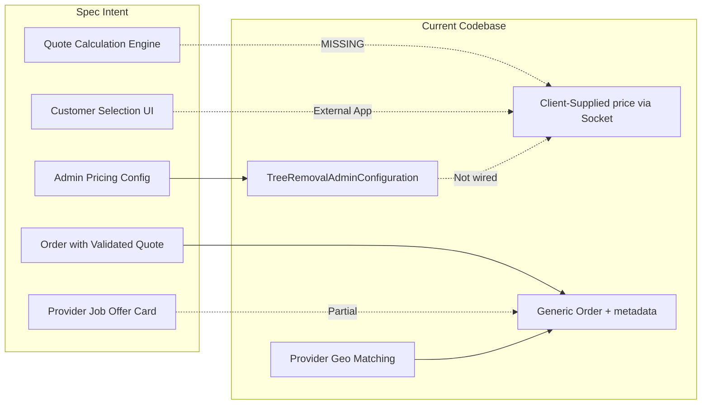

# Tree Removal System Gap Analysis Report

**Audit scope:** `c:\Users\arsla\Projects\Utecho\binsApp` (backend API + models + socket layer). No admin or mobile frontend exists in this repository.

**Spec reference:** Tree Removal Pricing Algorithm — Admin Panel Spec (Editable Values)

**Audit date:** August 3, 2026

---

## 1. Overall Compatibility & Match Percentage

| Scope | Match Score | Summary |
|-------|-------------|---------|
| **End-to-end (config + calc + customer + admin UI + provider card)** | **~32%** | Config data model is ~55% aligned; calculation, customer quote flow, admin UI tabs, and provider job card are largely unbuilt. |
| **Backend-only (models + APIs + order flow)** | **~42%** | Pricing config storage exists in a single MongoDB document; no quote engine, no region routing, no server-side price integrity. |

**Executive summary:** The codebase anticipated this spec at the **schema/storage layer** via [`src/models/TreeRemovalAdminConfiguration.js`](src/models/TreeRemovalAdminConfiguration.js), but stopped there. The spec's core value — **instant quote calculation from customer inputs** — is not implemented anywhere. Prices for Tree Removal orders are **client-supplied** via the `send-request-rentee` socket event ([`src/socket/socket.js`](src/socket/socket.js) ~L537), unlike commercial dumpster orders which use server-authoritative quoting in [`src/utils/commercialPricing.js`](src/utils/commercialPricing.js).

The existing implementation is closer to **Spec Option A (single JSON config)** than Option B (normalized tables), but lacks `region`, `service_type`, `is_active`, and a dedicated quote service.



---

## 2. Fully Matched Features (What's Already Done)

### 2.1 Pricing config data structure (conceptual 100% match on tier categories)

| Spec Section | Current Implementation | Location |
|--------------|------------------------|----------|
| Height tiers (base price + manual review flag) | `height_tiers[]` with `minimum_height`, `maximum_height`, `base_price`, `trigger_manual_review` | [`src/models/TreeRemovalAdminConfiguration.js`](src/models/TreeRemovalAdminConfiguration.js) L14–21 |
| DBH / diameter add-ons | `dbh_tiers[]` with `minimum_diameter`, `maximum_diameter`, `add_on_fee`, `trigger_manual_review` | Same file L24–31 |
| Tree type multipliers | `type_multipliers`: standard 1.0, hardwood 1.15, palm 1.10, unknown 1.05 | Same file L34–39 |
| Accessibility fees | `access_fees`: easy 0, moderate 200, difficult 450 | Same file L42–46 |
| Hazard fees | `hazard_fees`: power_lines 500, near_structure 400, tight_drop_zone 250, emergency_same_day 250 | Same file L49–54 |
| Crane hazard → manual review | `hazard_fees.crane_likely.trigger_manual_review: true` | Same file L54 |
| Global floor + cap fields | `global_rules.min_price_floor`, `global_rules.max_instant_quote` | Same file L8–11 |
| Joi validation mirroring schema | `updateTreeRemovalSchema` | [`src/modules/dumbster/validation.js`](src/modules/dumbster/validation.js) L234–296 |
| Swagger API documentation for config shape | PUT/GET `/api/dumbster/tree-removal` | [`src/modules/dumbster/routes.js`](src/modules/dumbster/routes.js) L47–204 |

### 2.2 Admin config CRUD APIs (storage layer)

| Endpoint | Auth | Purpose |
|----------|------|---------|
| `PUT /api/dumbster/tree-removal/:id` | Admin | Upsert pricing config (`upsert: true`) |
| `GET /api/dumbster/tree-removal` | **Public** (no auth) | List configs with pagination/search |

**Service:** [`src/modules/dumbster/service.js`](src/modules/dumbster/service.js) — `updateTreeRemoval()`, `getAllTreeRemoval()`

### 2.3 Tree Removal as a first-class service in order lifecycle

| Feature | Location |
|---------|----------|
| `service_type: "Tree Removal"` enum on Order | [`src/models/Order.js`](src/models/Order.js) L34–37 |
| `treeRemoval` ref on Order (links to provider profile) | [`src/models/Order.js`](src/models/Order.js) L22–25 |
| `Order.images[]` — can store customer photos | [`src/models/Order.js`](src/models/Order.js) L30–33 |
| `Order.metadata` — flexible Mixed field for quote inputs | [`src/models/Order.js`](src/models/Order.js) L202–205 |
| Provider geo-matching for Tree Removal (50 mi `$geoNear`) | [`src/socket/socket.js`](src/socket/socket.js) L427–489, L800–863 |
| Provider accept/match links `treeRemoval` profile to order | [`src/socket/socket.js`](src/socket/socket.js) L1822–1879 |
| Service type normalization (`"tree removal"`, `"treeremoval"`) | [`src/socket/socket.js`](src/socket/socket.js) L86–87 |

### 2.4 Provider onboarding (separate from pricing, but spec-adjacent)

| Feature | Location |
|---------|----------|
| Provider profile model (`TreeRemoval`) | [`src/models/TreeRemoval.js`](src/models/TreeRemoval.js) |
| User applies via profile update | [`src/modules/users/service.js`](src/modules/users/service.js) |
| Admin approve/reject + email notifications | [`src/modules/admin/service.js`](src/modules/admin/service.js) — `_updateServiceStatus()` |
| Admin list/delete APIs | [`src/modules/admin/routes.js`](src/modules/admin/routes.js) |

---

## 3. Partial Matches & Required Modifications

### 3.1 Config storage model vs spec tables

| Spec | Current | Gap |
|------|---------|-----|
| Option A: `pricing_configs` with `service_type`, `region`, `config_json`, `is_active` | Single doc `TreeRemovalAdminConfiguration` with flat nested fields | Missing `region`, `service_type`, `is_active`; no JSON wrapper; no multi-region support |
| Option B: 6 normalized tier tables + rules table | All tiers embedded in one Mongoose document | Not normalized; functionally similar to Option A but without region key |

**Required change:** Add `region` (default `"global"`), `is_active`, and optionally `service_type: "tree_removal"` to the config model; add region-aware lookup in quote engine.

### 3.2 Field naming mismatches

| Spec Name | Current Name | Files |
|-----------|--------------|-------|
| `min_ft` / `max_ft` | `minimum_height` / `maximum_height` | Model + validation |
| `min_in` / `max_in` | `minimum_diameter` / `maximum_diameter` | Model + validation |
| `add_price` (DBH) | `add_on_fee` | Model + validation |
| `manual_review` (bool on tier) | `trigger_manual_review` | Model + validation |
| `access_level` enum | Object keys on `access_fees` | Model (no formal enum) |
| `tree_type` enum | Object keys on `type_multipliers` | Model (no formal enum) |
| `hazard_type: emergency` | `emergency_same_day` | Model (spec itself is inconsistent here) |
| `is_active` | `status: "active" \| "deactive"` in validation only | Validation L294; **not in Mongoose schema** |

**Required change:** Either alias fields in API responses for spec compliance, or document mapping layer. Fix schema/validation mismatch on `status`.

### 3.3 Default values differ from spec starter set

| Rule | Spec Default | Current Default | File |
|------|-------------|-----------------|------|
| `min_price_floor` | **399** | **450** | `TreeRemovalAdminConfiguration.js` L9 |
| `max_instant_quote` | **3500** | **5000** | L10 |
| Height tier rows (0–20 @ 450, etc.) | 5 preloaded tiers | **Empty array** (no schema defaults) | L14–21 |
| DBH tier rows (0–12 @ +0, etc.) | 5 preloaded tiers | **Empty array** | L24–31 |
| Type/access/hazard defaults | Match spec | Match spec | L34–54 |

**Required change:** Seed script or `resetToDefaults` endpoint with spec starter values; align floor/cap defaults.

### 3.4 Manual review rules — partial only

| Spec Rule | Current State |
|-----------|---------------|
| Per-tier `manual_review` on height 80+ ft | Field exists (`trigger_manual_review`); no tier data seeded |
| Per-tier `manual_review` on DBH 48+ in | Field exists; no tier data seeded |
| `crane_likely` → manual review | Implemented (`trigger_manual_review: true`) |
| `manual_review_if_hazards_count_gte: 2` | **Missing** |
| `manual_review_if_quote_gte: 3500` | Partial — `max_instant_quote` exists but set to 5000 and **never evaluated** |
| `manual_review_if_height_gte_ft: 80` | **Missing** (only per-tier flag, no global rule) |
| `manual_review_if_diameter_gte_in: 48` | **Missing** |

**Required change:** Add 4 global rule fields to `global_rules` and implement evaluation in quote engine.

### 3.5 Admin API gaps vs spec UI actions

| Spec UI Action | Current API |
|----------------|-------------|
| Save (per tab) | `PUT /api/dumbster/tree-removal/:id` — saves entire config blob (works, but no tab-level granularity) |
| Reset to Defaults | **No endpoint** |
| Duplicate to New Region | **No endpoint** |
| GET single config by ID | Controller exists; **route commented out** (`routes.js` L228) |
| Toggle config active/inactive | `updateTreeRemovalStatus()` exists; **no route wired** |

### 3.6 Calculation formula — documented intent only

The schema comments describe the intended formula, but **zero runtime code** implements:

```
quote_raw = (base_price + dbh_add + access_add + hazard_sum) * type_multiplier
quote = max(quote_raw, min_price_floor)
if quote > max_instant_quote OR manual_review triggers → manual_review_required = true
```

Reference pattern exists in [`src/utils/commercialPricing.js`](src/utils/commercialPricing.js) (`quoteCommercialDumpster()`) but no `quoteTreeRemoval()` equivalent.

### 3.7 Order / provider flow — generic, not tree-specific

| Spec Requirement | Current State |
|------------------|---------------|
| Customer selects height/diameter/type/access/hazards | No validated input schema; may be passed ad-hoc in `metadata` |
| System calculates instant price | Price from client socket payload (`authoritativePrice = Number(price)`) |
| 3 photos on job offer | `Order.images[]` exists; **no min-3 enforcement** for tree removal |
| `manual_review_required` flag on offer | **Not stored** on Order |
| Computed quote breakdown on provider card | **Not stored**; commercial orders store `quoteBreakdown` in metadata, tree removal does not |

---

## 4. Missing Features (What Needs To Be Built)

### 4.1 Core calculation engine (highest priority)

- New utility: `src/utils/treeRemovalPricing.js` (mirror `commercialPricing.js` pattern)
- Functions needed:
  - `loadActiveConfig(region)` — region-aware config fetch
  - `quoteTreeRemoval({ heightFt, diameterIn, treeType, accessLevel, hazards, region })` — returns `{ quote, breakdown, manual_review_required, triggers }`
  - `validateTreeRemovalInputs()` — enum validation
- New API endpoint: `POST /api/dumbster/tree-removal/quote` (or `/api/tree-removal/quote`) for customer instant quote preview

### 4.2 Region-based config management

- `region` field on config document (nullable → `"global"`)
- Region resolution from customer address (similar to [`src/utils/commercialPricing.js`](src/utils/commercialPricing.js) `regionMatches()`)
- `POST /api/dumbster/tree-removal/duplicate-region` — clone config to new region
- `POST /api/dumbster/tree-removal/:id/reset-defaults` — restore spec starter set

### 4.3 Global manual review rules (schema + logic)

Add to `global_rules`:

```js
manual_review_if_hazards_count_gte: 2
manual_review_if_quote_gte: 3500
manual_review_if_height_gte_ft: 80
manual_review_if_diameter_gte_in: 48
```

### 4.4 Customer quote input capture (Order layer)

Structured fields or validated `metadata` keys:

- `height_tier` / `heightFt`
- `diameter_tier` / `diameterIn`
- `tree_type`
- `access_level`
- `hazards[]`
- `manual_review_required`
- `quote_breakdown` (itemized: base, dbh, access, hazards, multiplier, floor applied)

### 4.5 Server-side price integrity on order creation

In `send-request-rentee` ([`src/socket/socket.js`](src/socket/socket.js)):

- When `service_type === "Tree Removal"`, call `quoteTreeRemoval()` instead of trusting client `price`
- Reject or flag mismatches between client price and server quote
- Store quote result on `Order.metadata`

### 4.6 Admin Panel UI (external repo — not in binsApp)

All 6 tabs from spec are **completely absent** from this repository:

1. Height Pricing
2. Diameter Add-ons
3. Type Multipliers
4. Accessibility Fees
5. Hazard Fees
6. Rules & Caps

Plus buttons: Save, Reset to Defaults, Duplicate to New Region.

Evidence points to external admin at `binsapp.ai` ([`docs/BinsApp-Fixes-Summary.html`](docs/BinsApp-Fixes-Summary.html), `FRONTEND_URL` in env config).

### 4.7 Provider job offer card (external mobile app)

Spec requires provider-facing display of:

- Customer-selected inputs (height, DBH, type, access, hazards)
- 3 photos
- Computed quote
- `manual_review_required` flag

Backend currently sends generic dispatch notifications linking to `https://api.binsapp.ai/offers` ([`src/utils/dispatchWorker.js`](src/utils/dispatchWorker.js)) with no tree-specific payload.

### 4.8 Database seed / migration

- No seed script populates the 5 height tiers, 5 DBH tiers, or global rules from spec Section 3
- Backup folder contains empty metadata only ([`backup/binsdevelopmentdb/treeremovaladminconfigurations.metadata.json`](backup/binsdevelopmentdb/treeremovaladminconfigurations.metadata.json))

### 4.9 Customer "estimate range / request review" flow

- No API or socket event for manual-review path
- No estimate range calculation when `manual_review_required = true`

---

## 5. Extra / Out-of-Spec Implementation

These exist in the codebase but are **not mentioned** in the Tree Removal Pricing spec:

| Feature | Location | Notes |
|---------|----------|-------|
| **Provider onboarding model** (`TreeRemoval` — licenses, COI, arborist creds, bookings) | [`src/models/TreeRemoval.js`](src/models/TreeRemoval.js) | Separate business domain; keep but don't conflate with pricing config |
| **Provider approval admin APIs** (approve/reject documents) | [`src/modules/admin/service.js`](src/modules/admin/service.js) | Operational, not pricing |
| **`description` field** on pricing config | `TreeRemovalAdminConfiguration.js` L5 | Admin note; not in spec |
| **`disposal_notes`** in validation (L295) but commented out in schema | validation.js / model | Dead/legacy field |
| **Naming collision:** dumbster service imports pricing config as `TreeRemoval` | [`src/modules/dumbster/service.js`](src/modules/dumbster/service.js) L10 | Confusing alias vs provider model |
| **Fixed 50-mile geo radius** in socket matching | `socket.js` | Spec doesn't define; provider profile has `radius` (default 25 mi) but it's unused in matching |
| **Wallet / Stripe / invoice payment flows** for tree orders | `socket.js` | Payment infra beyond pricing spec |
| **Order extension, expiry cron, overdue charges** | Various utils | Residential/commercial lifecycle; not in tree pricing spec |
| **JunkRemovalAdminConfiguration** parallel model | [`src/models/JunkRemovalAdminConfiguration.js`](src/models/JunkRemovalAdminConfiguration.js) | Same incomplete pattern (config without calc) |
| **`service_metadata.photos_required_min: 3`** on junk config only | JunkRemovalAdminConfiguration.js L43 | Spec mentions 3 photos for tree removal; only junk has this concept |
| **Commercial dumpster pricing engine** | [`src/utils/commercialPricing.js`](src/utils/commercialPricing.js) | Different service; useful reference implementation |
| **Provider `bookings` availability blocking** | `TreeRemoval.js` L64–67, socket cancel handler | Scheduling; not in pricing spec |
| **Public GET on pricing config** (no auth) | `dumbster/routes.js` L204 | Security concern; not spec-defined |

---

## 6. Code Destruction / Refactoring Impact Analysis

### 6.1 Low-risk additions (no deletion required)

- Add `quoteTreeRemoval()` utility — new file, no breaking changes
- Add global manual review fields to `global_rules` — backward compatible (new optional fields)
- Add `region`, `is_active` to config schema — backward compatible with default `"global"`
- Wire quote validation into `send-request-rentee` — **behavior change** but not schema deletion

### 6.2 Medium-risk modifications (potential breaking changes)

| Change | Impact | Dependents |
|--------|--------|------------|
| **Enforce server-side price** on Tree Removal orders | Mobile app must stop sending arbitrary `price`; must send quote inputs instead | `send-request-rentee` socket contract, mobile customer app |
| **Change default `min_price_floor` (450→399) and `max_instant_quote` (5000→3500)** | Existing DB configs retain old values until reset; new defaults only apply on fresh seed | Admin panel, any client reading defaults |
| **Rename fields to match spec** (`add_on_fee` → `add_price`, etc.) | Breaks admin frontend if already built against current API | External admin UI, Swagger consumers |
| **Enable GET `/tree-removal/:id`** (currently commented) | Safe addition; but exposing config publicly may need auth review | Admin UI |
| **Add auth to GET `/tree-removal` list** | Breaks any public/unauthenticated consumer of pricing config | Mobile app if it reads config client-side |
| **Fix `status` field** — add to Mongoose schema or remove from validation | `getAllTreeRemoval()` filters by `status` ([`dumbster/service.js`](src/modules/dumbster/service.js) L291–293) but field isn't in schema — queries may silently fail | Admin list endpoint |

### 6.3 High-risk / deprecation candidates (only if strict spec enforcement)

| Current Code | Spec Action | Breaking Impact |
|--------------|-------------|-----------------|
| Client-supplied `price` for Tree Removal | **Deprecate** — replace with server quote | All existing mobile app versions sending raw price |
| `TreeRemovalAdminConfiguration` flat document | Could migrate to `pricing_configs` table with `config_json` wrapper | All `/api/dumbster/tree-removal` consumers |
| `emergency_same_day` hazard key | Rename to `emergency` per spec enum | Admin UI + any stored configs |
| `description`, `disposal_notes` on config | Remove if strict spec | Admin UI fields |
| Dumbster module hosting tree pricing routes (`/api/dumbster/tree-removal`) | Move to dedicated `/api/tree-removal-pricing` module | Route URLs, Swagger, admin frontend |
| Pricing config imported as `TreeRemoval` in dumbster service | Rename import to avoid collision with provider model | Internal only — low external impact |

### 6.4 No deletion recommended for provider onboarding

The `TreeRemoval` provider model and admin approval flow are **out of spec scope** but required for marketplace operations. Do not delete — keep as parallel domain.

---

## 7. Step-by-Step Implementation Roadmap

### Phase 1 — Foundation (low risk, no breaking changes)

1. **Fix schema/validation drift:** Add `status` and `is_active` to `TreeRemovalAdminConfiguration` Mongoose schema; align with Joi validation.
2. **Add missing global rules fields** to `global_rules` in model + validation.
3. **Create seed/defaults script:** Populate spec Section 3 starter values (5 height tiers, 5 DBH tiers, corrected floor/cap).
4. **Wire dead endpoints:** Enable `GET /tree-removal/:id`; add route for `updateTreeRemovalStatus`; add `POST .../reset-defaults`.
5. **Add `region` field** to config model (default `"global"`).

### Phase 2 — Quote engine (core spec delivery)

6. **Build `src/utils/treeRemovalPricing.js`:**
   - Input validation (enums for tree_type, access_level, hazards)
   - Tier lookup (height → base, DBH → add-on)
   - Hazard summation + crane_likely manual review
   - Type multiplier application
   - Floor/cap enforcement
   - All 6 manual review trigger evaluations
7. **Add `POST /api/dumbster/tree-removal/quote`** — stateless quote preview for customer app.
8. **Unit-test the formula** against spec worked examples (manual test cases from Section 3 defaults).

### Phase 3 — Order integration (behavior change — coordinate with mobile team)

9. **Extend `send-request-rentee`** for `service_type === "Tree Removal"`:
   - Accept structured quote inputs (height, diameter, tree_type, access_level, hazards[])
   - Call `quoteTreeRemoval()` server-side
   - Store `quote`, `quote_breakdown`, `manual_review_required` in `Order.metadata`
   - Use server quote as `authoritativePrice` (reject client price mismatch beyond tolerance)
10. **Enforce min 3 photos** for tree removal orders (validate `images.length >= 3`).
11. **Include tree quote payload in dispatch notifications** to providers.

### Phase 4 — Admin enhancements

12. **Add `POST /api/dumbster/tree-removal/duplicate-region`** — clone config to new region.
13. **Add region-aware config lookup** — resolve config by customer address region, fallback to global.
14. **Add auth to GET list endpoint** (or separate public vs admin routes).
15. **Rename dumbster import** (`TreeRemoval` → `TreeRemovalAdminConfiguration`) — internal cleanup.

### Phase 5 — External frontend (separate repos)

16. **Admin UI:** Build 6-tab pricing screen consuming Phase 1–4 APIs (external admin repo at binsapp.ai).
17. **Customer app:** Quote selection flow calling `POST .../quote`; manual review UX when flagged.
18. **Provider app:** Job offer card showing inputs, 3 photos, quote, manual review flag.

### Phase 6 — Hardening

19. **Migration script** for existing Tree Removal orders (backfill metadata if quote inputs exist).
20. **Audit logging** on config changes (who changed pricing, when).
21. **Integration tests** for full flow: config → quote → order → dispatch notification.

---

## Appendix: Spec vs Code Quick Reference

| Spec Component | Status | Match |
|----------------|--------|-------|
| Height tiers storage | Schema exists, no data | 70% |
| DBH tiers storage | Schema exists, no data | 70% |
| Type multipliers | Fully defaulted | 100% |
| Access fees | Fully defaulted | 100% |
| Hazard fees | Fully defaulted (naming drift on emergency) | 95% |
| Global rules (floor/cap) | Fields exist, wrong defaults | 60% |
| Global manual review rules (4 triggers) | Missing | 0% |
| Region support | Missing | 0% |
| Calculation formula | Not implemented | 0% |
| Admin UI (6 tabs) | Not in repo | 0% |
| Reset / Duplicate region | Missing | 0% |
| Customer instant quote | Client-side price only | 0% |
| Provider job offer card | Generic order only | 25% |
| Server price integrity | Missing | 0% |

**Recommended approach:** Extend the existing `TreeRemovalAdminConfiguration` document (Option A style) rather than creating 6 normalized tables — the schema is already 70% aligned. Focus engineering effort on the **quote engine** and **order integration**, which deliver 80% of the spec's business value.
