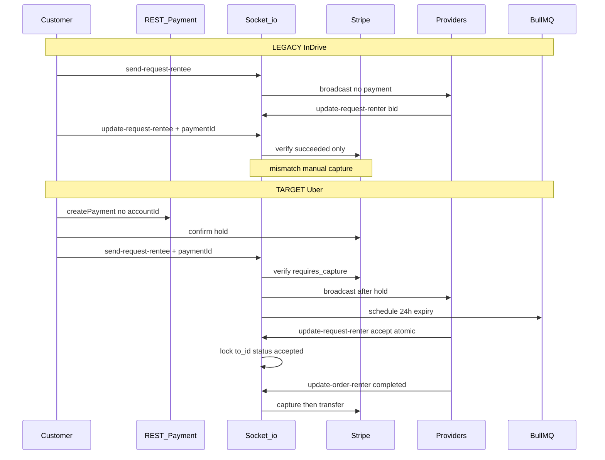
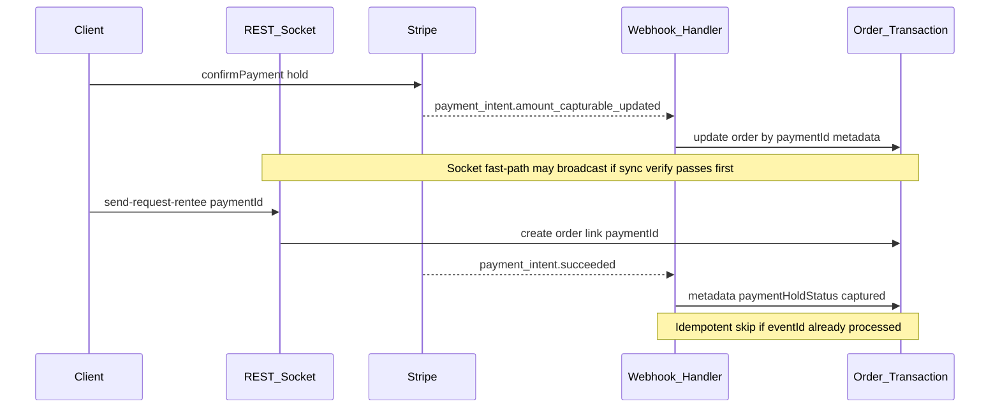
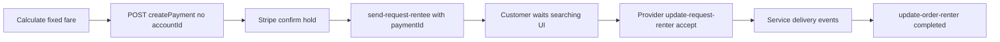

# Uber-Style Payment-First Matching Migration

## Decisions Locked In

| Decision | Choice |
|----------|--------|
| Scope | All 4 service types at once |
| Legacy bidding | Full replacement (no offer selection) |
| No-match timeout | 24-hour passive window → BullMQ delayed job voids hold |
| Settlement trigger | `update-order-renter` with `status: "completed"` (renter-only) |
| Schema | **Order model unchanged** — use existing `paymentId`, `to_id`, `status`, `metadata`, `driveaway`, `cancelation`. **Request collection removed** (explicitly approved) |
| Payment truth | Stripe webhooks + socket sync verify as fast-path fallback |

## Current vs Target Flow



## State Machine (No Schema Changes)

Use existing `Order.status` + field combinations:

| State | `status` | `paymentId` | `to_id` | Meaning |
|-------|----------|-------------|---------|---------|
| Searching | `pending` | set | null | Hold active, awaiting first accept |
| Matched | `accepted` | set | set | Provider locked, service in progress |
| Settled | `completed` | set | set | Captured + provider paid |
| Released | `cancelled` | set/null | null/set | Hold voided or admin cancel |

Store auxiliary data in **`order.metadata`** (already `Mixed`):
- `insurance_protection`, `cancellation_insurance` (from payment step)
- `paymentHoldStatus`: `requires_capture` | `captured` | `cancelled`
- `searchExpired`: `true` + `searchExpiredAt` (24h job)
- `matchedAt`, `providerAccountId` (set on first accept)

Use `cancelled` instead of a new `expired` enum value.

---

## Phase 1 — Payment Hold Before Broadcast

### 1A. REST payment layer

**Files:** [`src/modules/payment/validation.js`](src/modules/payment/validation.js), [`src/modules/payment/service.js`](src/modules/payment/service.js)

- Make `accountId` **optional** in `createPaymentSchema` (service already supports omission).
- Add a small exported helper (new file recommended: [`src/utils/paymentHold.js`](src/utils/paymentHold.js)) to centralize Stripe calls:
  - `verifyHold(paymentId)` — accept `requires_capture` (and optionally `succeeded` for idempotency); reject `canceled`, `requires_payment_method`, etc.
  - `releaseHold(paymentId)` — `stripe.paymentIntents.cancel()` with try/catch + structured logging
  - `captureHold(paymentId, { amountToCapture? })` — `stripe.paymentIntents.capture()`
  - `computeSplit(price, { driveaway, cancelation, insurance })` — reuse existing privacy fee logic from [`update-order-renter`](src/socket/socket.js) (lines ~2269–2282)

**Stripe rule:** Never pass `transfer_data` / `application_fee_amount` when `accountId` is absent at create time (already correct in `createPayment`).

### 1B. `send-request-rentee` refactor

**File:** [`src/socket/socket.js`](src/socket/socket.js) (lines 133–654)

**New required payload fields:** `paymentId`, `driveaway`, `cancelation` (insurance amounts can live in `metadata` or be passed explicitly).

**New gate sequence (before provider discovery / broadcast):**
1. Validate `paymentId` present.
2. Call `verifyHold(paymentId)` fast-path — **do not broadcast** if hold is invalid.
3. Create order with `paymentId`, `driveaway`, `cancelation`, `price`, and `metadata` insurance fields; set `metadata.paymentHoldStatus: 'pending_webhook'` until webhook or sync verify confirms.
4. Update duplicate-order guard: block if user already has `status: "pending"` with `paymentId` set (searching), not just `paymentId: null`.
5. Create debit `Transaction` (idempotent with webhook — check `stripePaymentIntentId` first).
6. **Then** run existing geo/provider discovery for all 4 `service_type` branches.
7. Broadcast + `DispatchService.initializeDispatchWaves` (unchanged infrastructure).
8. Schedule **24h expiry job** (see Phase 4).
9. **Fix duplicate admin notification** — single admin path in `notificationPromises` only (Phase 7).

**Remove:** immediate broadcast before payment validation.

---

## Phase 2 — First-Accept Wins (Replace Bidding)

### 2A. Rewrite `update-request-renter` accept path

**File:** [`src/socket/socket.js`](src/socket/socket.js) (lines 905–1258)

**Reject path:** keep `rejected_by` + `JOB_REJECTED` logging (no `Request` doc needed).

**Accept path — replace bidding with atomic assignment:**

```javascript
// Pseudocode — single atomic gate
const matched = await Order.findOneAndUpdate(
  {
    _id: orderId,
    status: "pending",
    to_id: null,
    paymentId: { $ne: null },
    rejected_by: { $ne: senderId }, // optional: allow re-attempt after reject
  },
  {
    $set: {
      to_id: senderId,
      status: "accepted",
      dustbin: /* from payload */,
      junkRemoval: /* resolved */,
      treeRemoval: /* resolved */,
      "metadata.matchedAt": new Date(),
      "metadata.providerAccountId": provider.accountId,
    },
  },
  { new: true }
);
if (!matched) return callback({ success: false, message: "Already assigned or unavailable" });
```

**Merge booking logic** currently in `update-request-rentee` (lines 1382–1525) into this handler **after** atomic lock succeeds:
- Dumbster / Porta Potty: dustbin overlap check + `bookings.push` + `availableQuantity` decrement
- Junk / Tree: profile ownership + approved status + `bookings.push`
- Set `order.junkRemoval` / `order.treeRemoval` refs

**Remove on accept:**
- `new Request(...)` creation
- `$addToSet: { accepted_by: senderId }`
- `receive-request-rentee` response shape that returns `request` array / offer count

**After match:**
- `DispatchService.cancelRemainingWaves(orderId)` (already exists)
- `User` `$inc` `ordersDetails.total` + `ordersDetails.accepted` (from `update-request-rentee`)
- `JOB_ACCEPTED` `JobEvent` + score recalc
- Notify customer: "Provider matched" (not "new offer")
- Emit `update-request-renter` / `update-request-rentee` equivalents with **order** payload (customer no longer picks)

**Race safety:** Only the first `findOneAndUpdate` that matches `to_id: null` wins; concurrent accepts get a clean failure response (no double booking, no double assignment).

### 2B. Remove `update-request-rentee` handler

**File:** [`src/socket/socket.js`](src/socket/socket.js) (lines 1261–1671)

- **Delete** the entire `update-request-rentee` socket handler (user chose full replace — no offer selection).
- Clients must stop calling this event; offer-selection UI is retired.
- Payment verification (`status === "succeeded"`) is eliminated — incompatible with `capture_method: "manual"` (`requires_capture`).

### 2C. Dispatch worker alignment

**File:** [`src/utils/dispatchWorker.js`](src/utils/dispatchWorker.js) (lines 40–53)

Change skip condition from:
```javascript
order.accepted_by && order.accepted_by.length > 0
```
to:
```javascript
order.to_id != null || order.status !== "pending"
```

Update notification copy: "New Service Request" / "Accept to claim" (not "New Offer").

---

## Phase 3 — Capture & Settlement on Renter Complete

### 3A. Fix `update-order-renter` completion path

**File:** [`src/socket/socket.js`](src/socket/socket.js) (lines 2124–2528)

**Current bug:** Uses `stripe.transfers.create` without `paymentIntents.capture` — funds may still be an uncaptured hold.

**Target sequence when `status === "completed"`:**
1. Idempotency guard: if `order.transfer === true` or `metadata.paymentHoldStatus === "captured"`, skip Stripe.
2. `captureHold(order.paymentId)` — full amount (or partial later for cancellation penalties).
3. Compute provider payout via `computeSplit()` (existing driveaway/cancelation/15% logic).
4. `stripe.transfers.create({ destination: order.to_id.accountId, ... })` — only if capture succeeded and provider has verified `accountId`.
5. Set `transferId`, `transfer: true`, `metadata.paymentHoldStatus: "captured"`.
6. Create credit `Transaction` (existing pattern).
7. Set `order.status = "completed"` (existing).

**Do not** add `transfer_data` to the original PI at create time; provider is unknown until Phase 2. Separate charge + transfer at completion matches production constraints.

**Bug fix:** Remove duplicate `callback()` at lines 2513–2518 (callback already fired in completed branch at ~2418).

**Cancel path (`status === "cancelled"`):** Keep admin-request flow for post-match; for pre-match customer cancel (new, see 3B), release hold immediately.

### 3B. Pre-match customer cancellation (new socket handler or extend existing)

Add handler e.g. `cancel-order-rentee` (or REST in [`src/modules/order/service.js`](src/modules/order/service.js)):
- Guard: `user === senderId`, `status === "pending"`, `to_id == null`, `paymentId` set
- `releaseHold(paymentId)`
- `status: "cancelled"`, `metadata.searchExpired: false`, `metadata.cancelledBy: "customer"`
- `DispatchService.cancelRemainingWaves` + remove pending expiry job
- Notify providers search ended

Post-match cancel with penalty: **defer** to follow-up (partial capture) unless `cancelation` flag + fee amount already on order.

### 3C. `accept-order-rentee` — no settlement change

**File:** [`src/socket/socket.js`](src/socket/socket.js) (lines 1672–1882)

Keep as proof-of-work UX only (`proofOfWorkStatus`). Per your decision, **do not** trigger capture here.

---

## Phase 4 — 24-Hour Passive Expiry (No Schema Change)

### New BullMQ queue + worker

**Files:** [`src/utils/bullmq.js`](src/utils/bullmq.js), new [`src/utils/orderExpiryWorker.js`](src/utils/orderExpiryWorker.js), wire in app bootstrap (same place `initDispatchWorker` is called).

**On order creation in `send-request-rentee`:**
```javascript
orderExpiryQueue.add(
  "void-unmatched-hold",
  { orderId: newRequest._id, paymentId },
  { delay: 24 * 60 * 60 * 1000, jobId: `order-expiry-${newRequest._id}`, removeOnComplete: true }
);
```

**Worker logic:**
1. Load order; exit if `to_id != null` or `status !== "pending"` (already matched or terminal).
2. `releaseHold(paymentId)` if still `requires_capture`.
3. `Order.findOneAndUpdate` → `status: "cancelled"`, `metadata.searchExpired: true`, `metadata.searchExpiredAt: now`.
4. `DispatchService.cancelRemainingWaves(orderId)`.
5. Notify customer: hold released, no provider found.

**On successful match:** remove expiry job by deterministic `jobId` (mirror `cancelRemainingWaves` pattern).

---

## Phase 5 — Stripe Webhooks (Payment Source of Truth)

Production cannot rely solely on client socket/API responses (network drops, app kills). Webhooks reconcile payment state asynchronously and idempotently.

### 5A. Infrastructure

**New files:**
- [`src/modules/payment/webhookController.js`](src/modules/payment/webhookController.js) — event router
- [`src/modules/payment/webhookService.js`](src/modules/payment/webhookService.js) — business logic per event type

**Modified files:**
- [`src/config/app.js`](src/config/app.js) — register webhook route **before** `express.json()` using `express.raw({ type: 'application/json' })` on `POST /api/payment/webhook` only (Stripe signature verification requires raw body)
- [`src/modules/payment/routes.js`](src/modules/payment/routes.js) — mount webhook route **without** `authenticate` middleware
- [`src/config/env.js`](src/config/env.js) — add `STRIPE_WEBHOOK_SECRET` convict entry
- [`src/modules/payment/service.js`](src/modules/payment/service.js) — attach PI `metadata` on create: `{ userId, flow: 'booking_hold' }`



### 5B. Events to handle

| Stripe event | Action |
|--------------|--------|
| `payment_intent.amount_capturable_updated` | Find `Order` by `paymentId`; set `metadata.paymentHoldStatus: 'requires_capture'`, `metadata.holdConfirmedAt`; write `OrderTimeline` + optional debit `Transaction` if not already created; if order still `pending` + `to_id` null and broadcast not yet done, webhook can trigger deferred broadcast (or socket already did via fast-path) |
| `payment_intent.succeeded` | Set `metadata.paymentHoldStatus: 'captured'`; idempotency guard on `transfer` flag; reconcile with `update-order-renter` completion if socket path raced |
| `payment_intent.canceled` | If `pending` + `to_id` null → `status: 'cancelled'`, `metadata.searchExpired` or `metadata.holdReleasedBy: 'stripe'`; cancel dispatch waves + expiry job |
| `payment_intent.payment_failed` | Log + notify customer; do not broadcast |

### 5C. Idempotency & reconciliation

- Store processed Stripe `event.id` in `order.metadata.webhookEventIds[]` (no schema change — nested in `metadata`).
- Lookup key: `Order.findOne({ paymentId: event.data.object.id })`.
- If webhook arrives **before** `send-request-rentee` creates the order: buffer is unnecessary if client always calls socket immediately after confirm; as safety net, log event + optional Redis key `pi:ready:{paymentId}` with 5-min TTL for socket to consume (lightweight, no schema).
- [`src/models/Transaction.js`](src/models/Transaction.js) — webhook-created debit rows use `stripePaymentIntentId` + `metadata.source: 'webhook'` to prevent duplicates.
- [`src/models/OrderTimeline.js`](src/models/OrderTimeline.js) — audit entries for hold confirmed / captured / released via webhook.

### 5D. Socket + webhook dual path

`send-request-rentee` gate becomes:
1. **Fast-path:** `verifyHold(paymentId)` synchronously (existing helper).
2. **Authoritative:** proceed only if hold confirmed OR `metadata.paymentHoldStatus` already set by webhook.
3. Webhook always wins on conflict (reconcile stale socket state).

`update-order-renter` completion: socket triggers `captureHold`; webhook `payment_intent.succeeded` confirms and sets final ledger state (skip duplicate transfer if `transfer === true`).

---

## Phase 6 — Legacy / Dead Code Cleanup

Uber-style first-accept eliminates the `Request` bidding collection and offer-selection REST surface.

### 6A. Remove `Request` model

**Delete:** [`src/models/Request.js`](src/models/Request.js)

**Remove all imports/usages (only 2 files today):**
- [`src/socket/socket.js`](src/socket/socket.js) — `new Request()`, `Request.find*`, `Request.findByIdAndUpdate/Delete`
- [`src/modules/order/service.js`](src/modules/order/service.js) — `Request.find`, `Request.findOneAndDelete`, `Request.deleteMany`

**MongoDB:** Existing `requests` collection documents become orphaned; optional one-time admin script to archive/delete (out of band, not required for code deploy). No new collections.

### 6B. Refactor order REST endpoints (keep job listing, drop offer merge)

**File:** [`src/modules/order/service.js`](src/modules/order/service.js)

| Endpoint | Current behavior | Target behavior |
|----------|------------------|-----------------|
| `GET /api/order/renter/request` | Orders + nested `requests[]` bids | Orders only (`status: pending`, `paymentId` set, `to_id` null = claimable jobs) |
| `GET /api/order/rentee/request` | Same merge | Customer searching/matched orders — no `requests` array |
| `DELETE /api/order/renter/request/:id` | Deletes `Request` doc | **Remove** or repurpose → decline via `rejected_by` on `Order` (socket already handles reject) |
| `PUT /api/order/admin/cancel/:id` | Order cancellation admin | **Keep** — unrelated to bidding |
| `PUT /api/order/admin/refund/:id` | Order refund | **Keep** |
| `PUT /api/order/admin/transfer/:id` | Manual transfer | **Keep** |

**Files:** [`src/modules/order/routes.js`](src/modules/order/routes.js), [`src/modules/order/controller.js`](src/modules/order/controller.js) — update Swagger to remove `requests` nested schema; remove `deleteUserrequest` if no longer needed.

**Not in scope for removal:** Admin junk/tree/company **profile approval** endpoints in [`src/modules/admin/routes.js`](src/modules/admin/routes.js) — these are operator onboarding, not offer bidding.

### 6C. Socket event cleanup (align with Phase 2)

- Remove `update-request-rentee` handler entirely (user chose full replace).
- Remove `accepted_by` writes; field can remain on Order doc for historical reads but unused going forward.
- Update `receive-request-rentee` emission — order-only payload, no `count` / `request` bundle.

### 6D. Notification type cleanup

[`src/models/Notification.js`](src/models/Notification.js) enum includes `"offer"` — keep enum value for historical notifications; new Uber flow uses `"request"` / `"order"` only. No schema change required.

---

## Phase 7 — Fix Duplicate `adminNotiPromise` (Pre-existing Bug)

**Problem:** [`send-request-rentee`](src/socket/socket.js) (lines 592–642) and the repeat-request handler (lines 809–858) each send admin notifications **twice**:
1. Inside `notificationPromises.push(...)` when `adminUser` exists (correct path with `fcmtoken`)
2. Again via standalone `adminNotiPromise` block (duplicate emit + `sendNotification` with empty `fcmtoken`)

**Fix:**
- Delete the standalone `adminNotiPromise` IIFE + `.catch()` block in **both** handlers.
- Keep exactly one admin notification inside `notificationPromises` guarded by `if (adminUser)`.
- Remove stray `console.log("fcmtoken", ...)` debug line while touching the block.

**No changes needed** to [`src/utils/notifications.js`](src/utils/notifications.js), [`src/utils/notificationWorker.js`](src/utils/notificationWorker.js), or [`src/utils/notificationProcessor.js`](src/utils/notificationProcessor.js) — dedup is at call site only.

---

## Client Contract Changes (Mobile/Web)



| Event | Change |
|-------|--------|
| `send-request-rentee` | **Requires** `paymentId`; optional `driveaway`, `cancelation`, insurance in `metadata` |
| `update-request-renter` | Accept = claim job (no `price` bid); payload still needs `dustbin` / `junkRemoval` / `treeRemoval` per service |
| `update-request-rentee` | **Removed** — clients must stop offer-selection UI |
| `receive-request-renter` | Payload is order (not `{ request, count }` offer bundle) |
| `POST /api/payment/webhook` | **New** — Stripe async payment events (no auth; signature verified) |
| `GET /api/order/*/request` | Response drops nested `requests[]`; orders only |
| New | `cancel-order-rentee` (or REST) for pre-match cancel + hold release |

---

## Files Touched (Implementation Order)

1. [`src/modules/payment/validation.js`](src/modules/payment/validation.js) — optional `accountId`
2. **New** [`src/utils/paymentHold.js`](src/utils/paymentHold.js) — Stripe hold helpers
3. [`src/config/env.js`](src/config/env.js) — `STRIPE_WEBHOOK_SECRET`
4. **New** [`src/modules/payment/webhookService.js`](src/modules/payment/webhookService.js) + `webhookController.js`
5. [`src/config/app.js`](src/config/app.js) — raw-body webhook route before JSON parser
6. [`src/modules/payment/service.js`](src/modules/payment/service.js) — PI metadata on create
7. [`src/socket/socket.js`](src/socket/socket.js) — Phases 1–3, 7 dedup, Phase 6 Request removal
8. [`src/utils/dispatchWorker.js`](src/utils/dispatchWorker.js) — skip on `to_id`, copy updates
9. **New** [`src/utils/orderExpiryWorker.js`](src/utils/orderExpiryWorker.js) + queue export in [`bullmq.js`](src/utils/bullmq.js)
10. [`src/modules/order/service.js`](src/modules/order/service.js) + routes/controller — remove Request merge, update Swagger
11. **Delete** [`src/models/Request.js`](src/models/Request.js)
12. App entry (where workers init) — register expiry + webhook workers

**Explicitly not changing:** [`src/models/Order.js`](src/models/Order.js) field definitions, [`src/modules/scoring/scoreEngine.js`](src/modules/scoring/scoreEngine.js) (only called from socket handlers).

---

## Risk Mitigation Checklist

- **Every Stripe call** wrapped in try/catch with `logger.error`; never throw unhandled to socket process.
- **Atomic `findOneAndUpdate`** for first-accept (no read-then-write).
- **Idempotent capture** via `transfer` flag + `metadata.paymentHoldStatus`.
- **No new Socket.io namespaces** — extend existing events only.
- **Non-blocking:** `DispatchService.cancelRemainingWaves`, score recalc, notifications stay `.catch()` fire-and-forget where already done.
- **Load test focus:** concurrent accepts on same `orderId` must yield exactly one winner.
- **Webhook signature:** reject unsigned/invalid payloads with 400; never process unverified events.
- **Webhook idempotency:** dedupe on Stripe `event.id` before any DB write.
- **Stripe Dashboard:** register webhook URL `https://api.binsapp.ai/api/payment/webhook` for the four PI events above.

---

## Out of Scope (Follow-Up)

- Partial capture for post-match customer cancellation penalty
- One-time MongoDB archive script for orphaned `requests` collection data
- Migrating historical `accepted_by` / `Request` records into audit-only storage
